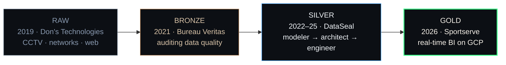

<p align="center">
  
</p>

<p align="center">
  <a href="https://doncoding-ai.github.io/Elito/"><b>Portfolio</b></a>&nbsp;&nbsp;·&nbsp;&nbsp;
  <a href="https://www.linkedin.com/in/elito0905/"><b>LinkedIn</b></a>&nbsp;&nbsp;·&nbsp;&nbsp;
  <a href="mailto:elito1236@gmail.com"><b>elito1236@gmail.com</b></a>
</p>

---

I started out mounting CCTV cameras and wiring office networks in Kenya.
Now I run the real-time data platform behind BI for an international sports betting and gaming operator — remotely, from Nairobi.

I design the whole system in my head before I write a line of it.
The goal is always the same: data nobody has to double-check.

<br>

### `$ status --now`

```yaml
role:      Senior Data Engineer, BI Streaming Platform @ Sportserve
since:     2026-01
markets:   6   # LATAM · India · Japan · Rest of Asia · Rest of World · brand market
shipping:  server-side event tracking, investigation → production in ~5 weeks
hardening: Firestore → BigQuery backfills, dedup, scheduler fixes, runtime upgrades
heading:   streaming systems that recover on their own
```

<br>

### `$ git log --career --oneline`

```diff
  2019  boot      Don's Technologies   CCTV, networks, client websites
  2021  audit     Bureau Veritas       data accuracy + compliance audits
  2022  model     DataSeal             40+ legacy schemas reverse-engineered · 15+ systems into Snowflake
  2023  design    DataSeal             warehouse architecture across 20+ source systems, Data Vault → reporting
  2024  migrate   DataSeal             on-prem SQL Server → Databricks + Snowflake lakehouse
+ 2026  stream    Sportserve           real-time BI on GCP across six markets
```

<br>

### Career, modelled as a medallion pipeline



<br>

### Stack I reach for

| Layer | Tools |
|---|---|
| **Ingest & stream** | Cloud Run · Cloud Functions · Eventarc · Pub/Sub · Kafka · server-side GTM |
| **Transform** | Python · SQL · PySpark · dbt · Airflow |
| **Store & serve** | BigQuery · Snowflake · Databricks · Firestore · GCS |
| **Govern** | Data Vault · dimensional modelling · Unity Catalog · MDM · RBAC |
| **Ship** | Docker · Git · CI/CD for Cloud Run |

<br>

### How I build

- **Design first, type second.** If I can't draw it, I'm not ready to code it.
- **Every pipeline needs a way back.** Backfill and replay are features, not chores.
- **Idempotent or it doesn't ship.** Running it twice should change nothing.
- **Boring in production is the compliment.**

<br>

### Off the clock

I write — poetry, spoken word, verses — and I'm developing a screenplay: a psychological thriller set in Nairobi.
Writing and data engineering turn out to be the same discipline. Structure, rhythm, and cutting everything that doesn't carry weight.

<br>

<p align="center"><sub>Built in Nairobi. Shipped to six markets.</sub></p>
